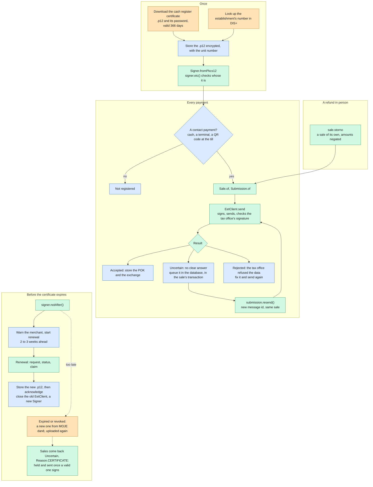

# What a merchant keeps an eye on

From the certificate to its renewal: who does each step. Colours: **the taxpayer** in MOJE daně or DIS+, **your
app**, and **this library**.

The details: [using the client](usage.md) for sending and resends, [renewing the certificate](renewal.md) for the
CA's API.
