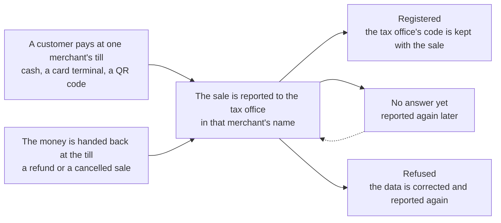

# eet-client

A Java client for [EET 2.0](https://eet.gov.cz/cs/pro-vyvojare), the Czech electronic sales registration that
starts on 2027-01-01. It builds the message, signs it with the taxpayer's certificate, sends it, checks the tax
office's signature on the answer and says what came of it, and renews the certificate through the CA's API. It needs
Java 21; besides the JDK it uses only jackson-core, for the renewal API.

It is built for a platform that registers sales for many merchants at once, a payment gateway or a marketplace:
each merchant is a taxpayer with a certificate of their own, and every sale is reported in that merchant's name.
One merchant registering their own sales is the same thing with a list of one.

Checked against the state's playground. Published on GitHub Packages, not Maven Central.

| Read | For |
|---|---|
| [What a merchant keeps an eye on](.docs/lifecycle.md) | the whole cycle in one diagram, from the certificate to its renewal, and who does each step |
| [Installing](.docs/install.md) | the artifact on GitHub Packages, for Gradle and Maven, and a prompt for a coding assistant |
| [Using the client](.docs/usage.md) | sending a sale, the four results, resends, stornos, what is left to you |
| [Renewing the certificate](.docs/renewal.md) | a new certificate from the CA's API before the old one expires |
| [The official interface](spec/README.md) | the state's WSDL, schema, sample requests and documents the tests read |
| [Development](.docs/development.md) | build, tests, the live playground test, releases |
| [llms.txt](llms.txt) | the setup and the mistakes to avoid, for a coding assistant adding the library to a project |

## What it covers

| Feature | This client |
|---|:---:|
| Registering a sale | ✅ |
| A dry run (verification mode) | ✅ |
| Sending an uncertain sale again | ✅, `submission.resend()`; the queue is yours |
| Storno of a sale | ✅ |
| Checking the tax office's signature on the answer | ✅ |
| Renewing the certificate through the CA's API | ✅, not on the playground, which has no CA |

Licence: [Apache 2.0](LICENSE)
